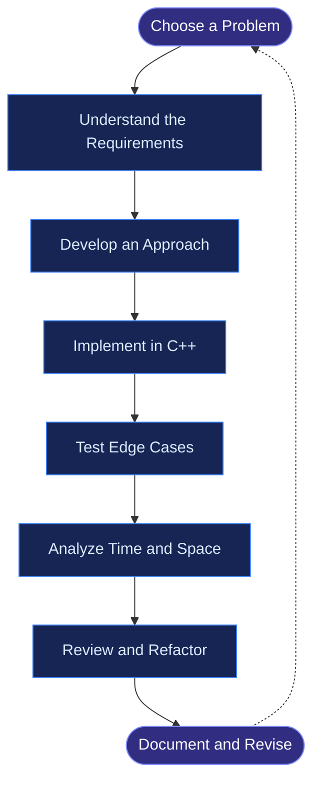
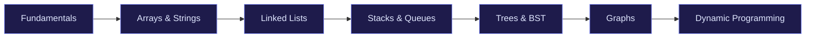

# ⚡ GFG-s-PY — DSA Practice Repository

<p align="center">
  
</p>

<p align="center">
  <b>A structured collection of Data Structures and Algorithms solutions, primarily implemented in C++, organized by difficulty and focused on consistent problem-solving practice.</b>
</p>

<p align="center">
  
  
  
  
</p>

---

## 📌 Table of Contents

- [About the Repository](#-about-the-repository)
- [Repository Structure](#-repository-structure)
- [Learning Workflow](#-learning-workflow)
- [Problem-Solving Roadmap](#-problem-solving-roadmap)
- [How to Run the Code](#-how-to-run-the-code)
- [Goals and Progress](#-goals-and-progress)
- [Connect](#-connect)

## 🎯 About the Repository

**GFG-s-PY** is my personal coding practice repository for improving algorithmic thinking, mastering data structures, and building strong foundations for technical interviews.

The repository organizes solutions by difficulty so that problems are easier to navigate, revise, and revisit.

### What you'll find here

- 📘 **Basic:** Fundamental programming and problem-solving concepts.
- 🟢 **Easy:** Core algorithms and essential data structures.
- 🟡 **Medium:** Pattern recognition and optimized approaches.
- 🔴 **Hard:** Advanced problems and algorithmic challenges.
- 💻 **C++ Extras:** Additional C++ implementations and practice material.

## 🗂️ Repository Structure

```text
GFG-s-PY/
│
├── Difficulty: Basic/
│   └── Fundamental problems
│
├── Difficulty: Easy/
│   └── Beginner-friendly solutions
│
├── Difficulty: Medium/
│   └── Intermediate problems
│
├── Difficulty: Hard/
│   └── Advanced problems and challenges
│
└── EXTRAS:C++/
    └── Additional C++ practice
```

*The folder names above reflect the repository's visible organization; individual files and subfolders may vary.*

## 🔄 Learning Workflow



## 🧠 Problem-Solving Roadmap



This roadmap is a general learning path, not a claim that every topic has already been completed in the repository.

## ⚙️ How to Run the Code

You will need a C++ compiler such as **g++**.

1. Clone the repository:

   ```bash
   git clone <YOUR_REPOSITORY_URL>
   ```

2. Navigate to the project directory:

   ```bash
   cd GFG-s-PY
   ```

3. Open the required solution file and compile it:

   ```bash
   g++ solution.cpp -std=c++17 -o solution
   ```

4. Run the compiled program:

   ```bash
   ./solution
   ```

   On Windows, run `solution.exe` instead.

   **Note:** Some GeeksforGeeks solutions use platform-provided function signatures or classes. Those submissions may need a custom `main()` function or the original platform's test harness to run locally.

## 📈 Goals and Progress

My focus is on developing consistency, writing cleaner code, understanding complexity, and revising previously solved problems.

- [ ] Strengthen core data structures and algorithms.
- [ ] Improve time and space complexity analysis.
- [ ] Practice common interview patterns.
- [ ] Revisit mistakes and optimize earlier solutions.
- [ ] Build consistency through regular coding practice.

## 🌟 My Philosophy

> Every problem solved is a step toward better logic, stronger fundamentals, and greater confidence in technical interviews.

I believe in understanding the logic behind a solution rather than simply memorizing code.

## 🤝 Connect

**Maintainer:** Abhinav

If you find this repository useful, consider giving it a ⭐ and exploring the solutions.

<p align="center">
  <b>Keep learning. Keep solving. Keep growing. 🚀</b>
</p>
